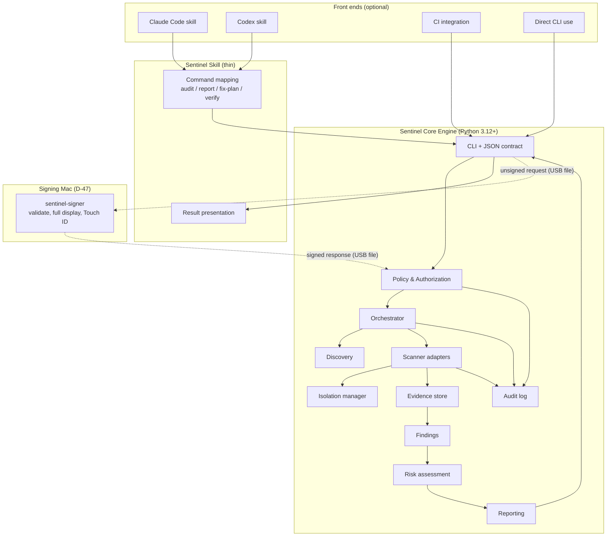
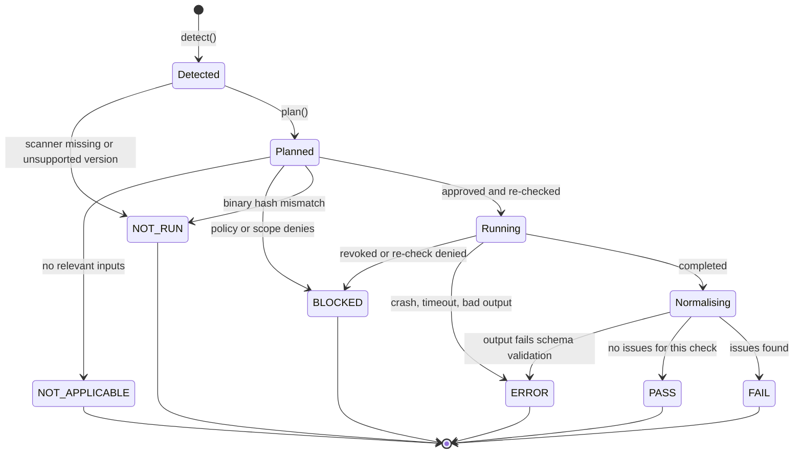
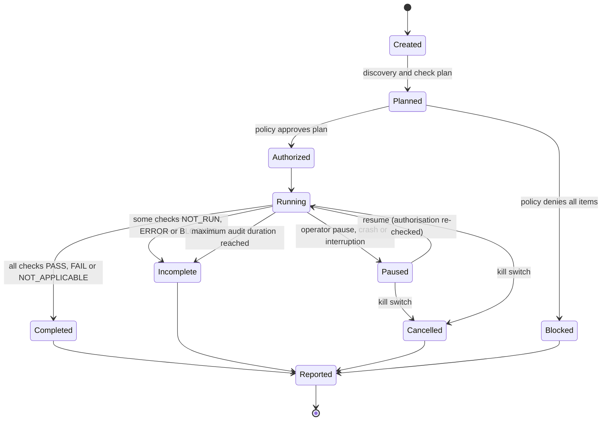
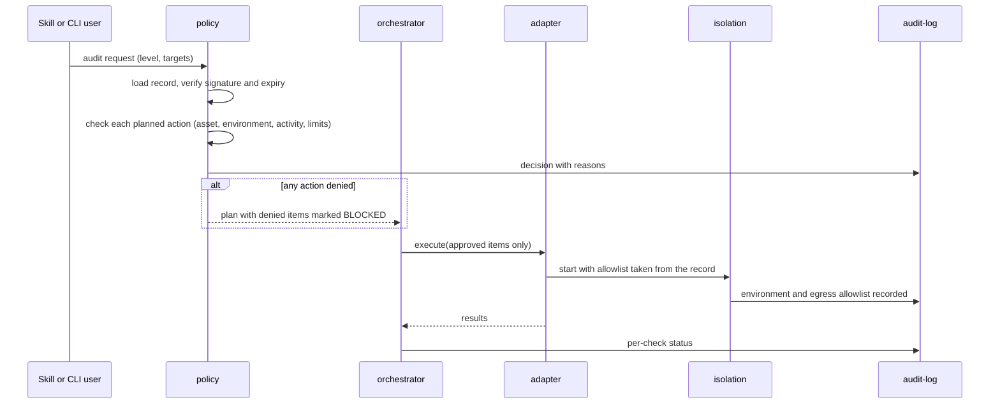
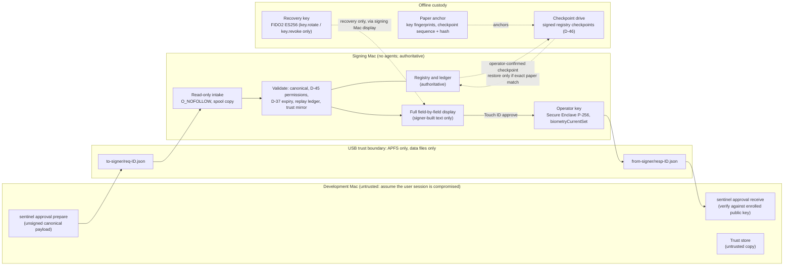
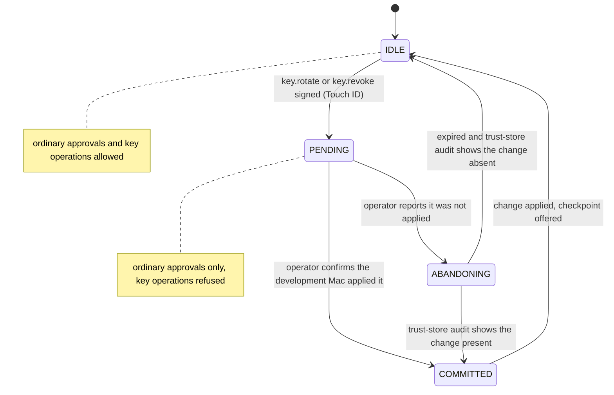
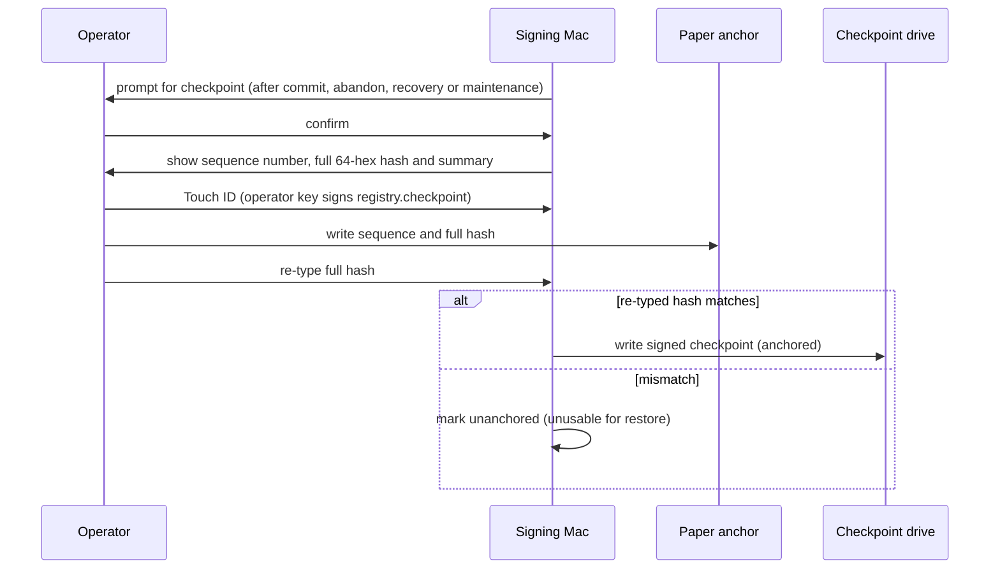
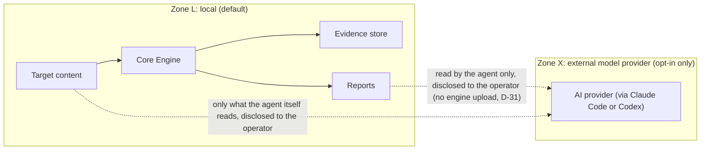
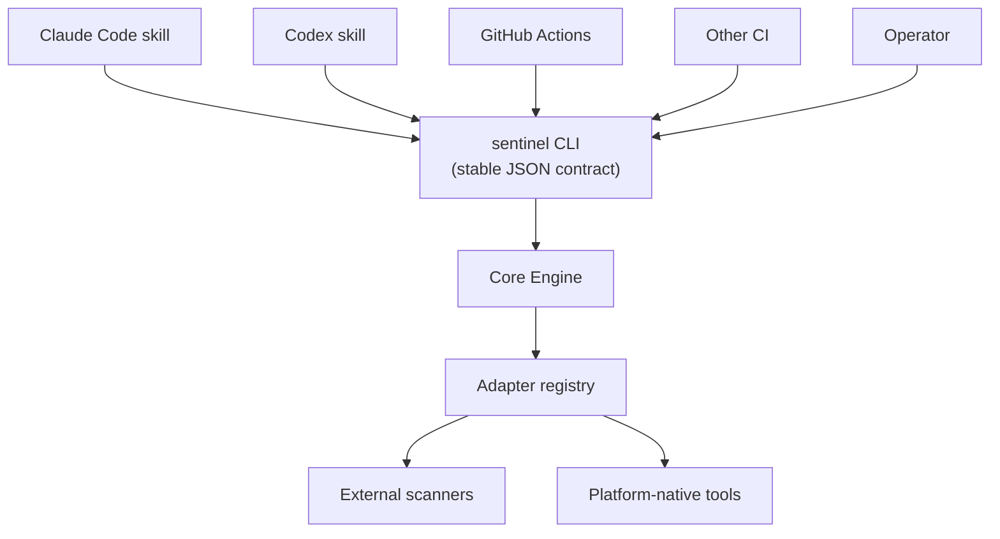
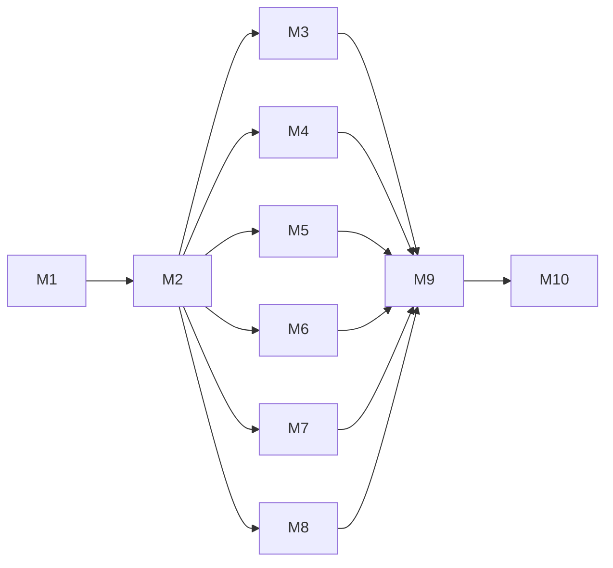

# Sentinel architecture discovery

**Status:** Architecture documentation, corrected after review (2026-11-08) and updated through the AFR-01 freeze remediation (2026-11-09). **Frozen as a design baseline (D-48, owner approval 2026-11-09);** later changes need a new dated decision. **Implementation status:** the M1 engine is partly implemented and tested (CLI, policy and authorisation, approvals, evidence and audit log, redaction, the S1 macOS sandbox, the fixture adapter, licence audit). See `docs/m1/progress.md` and `docs/m1/implementation-audit.md` for exactly what exists. `[P]` items are implemented only where those documents say so. **The separate signing device (D-45 to D-47) is designed but not implemented, and production operator signing is disabled.** Real scanner adapters, containers and VM isolation, the agent integrations and `fix-plan` aren't implemented

**Labels used here:**
- **[D-xx]**: a confirmed decision from the decision log in `docs/architecture-discovery-plan.md`.
- **[R-xx]**: an approved refinement: R-01–R-11 in §11.1, R-12–R-17 in §13.9.
- **[spec]**: a requirement taken directly from the owner's product specification.
- **[A]**: an assumption.
- **[P]**: a proposal **approved in principle** by the owner on 2026-11-08, subject to implementation validation. It is not yet implemented or tested.
- **[O-xx]**: an open question (O-01–O-10 all resolved on 2026-11-08 as D-15–D-24).

---

## 1. Product vision and objectives

Sentinel is a modular security **auditing** framework. It helps owners find, verify, prioritise and fix security weaknesses in software they own or are authorised to assess. Its output is evidence, not opinion.

**Objectives:**
1. **Evidence before confidence.** Every finding links to stored, reproducible evidence. Verified findings are kept separate from suspected ones [D-12].
2. **Coverage before claims.** Every audit says what was checked, what was not, and why. A domain is not claimed as covered until its fixtures and checks pass [D-09].
3. **Safety before automation.** Read-only by default [D-07]. Active steps need authorisation enforced in code [D-10].
4. **Independent core.** The engine runs with no AI agent installed. Agents are optional front ends [D-06, D-11].
5. **Local-first privacy.** No source code leaves the machine unless the owner opts in [D-05].

## 2. Scope and non-goals

**In scope:**
- All approved security domains D01–D14 [D-09], designed in full and delivered by milestone [D-14].
- Audit levels L1 Baseline, L2 Deep (default) and L3 Assurance [D-08].
- Four report types [D-12].
- Integrations for Claude Code, Codex and CI [D-06, D-11].

**Non-goals:**
- Autonomous or uncontrolled exploitation, and destructive testing.
- Any change to production systems.
- Remediation without explicit approval. Sentinel proposes fixes; it does not apply them.
- Running untrusted binaries during ordinary inspection.
- Reimplementing existing scanners. Sentinel orchestrates them and normalises their output [A].
- Declaring a target "secure". Sentinel reports findings, coverage and residual risk.

## 3. System architecture overview

The **Sentinel Skill** and the **Sentinel Core Engine** are separate products with one contract between them: the engine's CLI and its JSON schemas.

**Rules for the boundary:**
- The Skill holds **no security logic**. It turns a user request into a CLI call and presents the results.
- Every permission check happens in the engine. Instructions to an AI agent are never a safety control [D-10].
- The engine has no dependency on Claude Code, Codex or any provider API [D-06].
- Reports the Skill shows come from engine output files, so a run with the Skill and a run without it give the same results.

**Audit pipeline (from the product specification):**

## 4. Core module boundaries

Each module owns one responsibility and talks to the others only through typed records defined in `schemas/` [P]. Canonical JSON only, with versioned JSON Schemas required in M1 [D-40].

| Module | Owns | Inputs | Outputs | Must not |
|---|---|---|---|---|
| **cli** | Command parsing, exit codes, output paths | User or Skill arguments | Run manifest, report files | Make policy decisions |
| **policy** | Loading and verifying policies, authorisation records, suppressions and review decisions (§11.2); allow or deny each planned action | Audit request, signed trust-anchor files | Decisions with reasons | Run scanners, or accept a trust-anchor file without a valid operator signature [D-27] |
| **discovery** | Project and artifact detection, building the project profile | Target path or artifact (read-only) | `project-profile` | Execute target content |
| **threat-model** | Attack-surface and trust-boundary model for the profile | Project profile | Threat model and check plan | Run checks |
| **orchestrator** | Ordering, scheduling, timeouts, overall run state | Approved plan | Per-check status records | Bypass policy, or treat a failure as a pass |
| **adapters** | One adapter per scanner (§5) | Check plan item | Raw results and evidence references | Reach targets outside approved scope |
| **isolation** | Creating and destroying isolated execution environments [D-04] | Isolation profile | Execution handle and teardown record | Pass host credentials in |
| **evidence** | Content-addressed storage, hashing, redaction | Raw scanner output | Evidence records | Store secret values |
| **findings** | Normalisation, deduplication, verified vs suspected status | Evidence records | `finding` records | Promote a finding without evidence |
| **risk** | Severity and confidence (CVSS where applicable, plus context) | Findings and profile | Scored findings | Change evidence |
| **reporting** | The four report types, coverage matrix, checks not run | Run manifest, findings | Reports | Report "secure" |
| **audit-log** | Append-only record of decisions and executions | Events from every module | Hash-chained, run-key-signed log; tamper-evident only within the limits of §13.8 [D-34] | Be skipped or turned off |

**How untrusted repository content is handled [P]:**
- Everything in a target is untrusted input: files, build scripts, config, Git history, and text aimed at AI agents. Content is data. It never becomes an instruction to the engine or to the Skill.
- Discovery and static checks only read. They never run package scripts, build steps, Git hooks or project tools from the target.
- Parsers run with size, depth and time limits. Archives are unpacked in the isolation layer, never on the host.
- Symlinks are not followed outside the target root, and paths are checked against the root.
- Text that tries to steer an agent is recorded as a finding (D11), never acted on.
- Target config files can narrow what an audit does but can never widen it. Only the operator's policy and authorisation records widen scope.

## 5. Scanner adapter architecture

**Adapter interface [D-13]:**

| Method | Responsibility | Side effects allowed |
|---|---|---|
| `detect()` | Is the scanner installed? Report its version, path and licence | None |
| `plan(profile, level)` | Describe the checks it would run, which files and targets they touch, and its isolation needs | None |
| `validate_scope(plan, authorization)` | Confirm every target in the plan is within the authorised scope. The engine checks this again independently | None |
| `execute(plan, handle)` | Run only the planned, approved checks inside the given isolation handle | Only those allowed by the isolation profile |
| `normalize(raw)` | Convert raw output into evidence and candidate findings, with redaction | None |
| `health()` | Report errors, limitations and unsupported inputs | None |

The engine invokes adapters; an adapter never calls `execute` on itself or on another adapter.

Each adapter also declares a manifest:
- scanner name and the version range it supports;
- licence [D-03];
- the isolation profile it needs;
- whether it needs network access, and to what;
- the check IDs it can produce;
- its output schema version.

**Lifecycle and statuses:**

Each check ends in exactly one status: `PASS`, `FAIL`, `NOT_RUN`, `BLOCKED`, `ERROR` or `NOT_APPLICABLE` [D-12].

Before `Running`, the engine re-checks authorisation [R-03] and the scanner binary hash [R-16]. A hash mismatch gives `NOT_RUN` (`binary_hash_mismatch`). Revocation or a denied re-check during execution stops the process and gives `BLOCKED` [R-04, R-10].

**Failure handling:**
- A missing binary, timeout, crash, non-zero exit, truncated output or schema failure becomes `ERROR` or `NOT_RUN`. **It is never `PASS`** [D-12].
- `PASS` means the check ran fully and found no issues. It is not proof that the target is secure.
- A failed check doesn't stop the rest of the run unless policy marks it as required. Its status and reason go into the coverage matrix and "checks not run".
- Retries are bounded and recorded [P]. A result that only appears after a retry is labelled as such.
- An adapter whose `health()` reports a version outside its supported range is downgraded to `NOT_RUN`, never run anyway [P].
- The run records the exit status, duration, scanner version and a hash of the adapter configuration for every check [D-12].

## 6. Evidence and finding integrity

### 6.1 Evidence provenance [P]

Every evidence record answers: what produced it, from what input, under which authorisation, and whether it still matches its recorded hash. That is checked against the run-key-signed manifest, within the limits of §13.8 [D-34].

| Field | Content |
|---|---|
| `evidence_id` | Content address: `sha256` of the stored artifact |
| `audit_id`, `check_id` | The audit run and check that produced it (§8.3) |
| `producer` | Adapter name and version, scanner name, scanner version, scanner binary hash, and the `sha256` of the effective scanner configuration [D-12] |
| `input` | Source revision (commit ID and dirty-tree flag), or the artifact's `sha256`; the target path relative to the scope root |
| `authorization_ref` | Authorisation record ID and version, or `read-only-default` [D-07] |
| `isolation_ref` | Isolation profile and environment ID (§10) |
| `collected_at` | UTC timestamp from the engine, not from the scanner |
| `redaction` | Redaction rules applied, and a count of what was masked (§6.4) |
| `parent` | For derived evidence (for example a normalised result), the `evidence_id` of the raw output it came from |

### 6.2 Preserving original output [P]

- Raw scanner output (stdout, stderr, report files) is stored unchanged, first passing only through redaction (§6.4), in a **write-once evidence store** inside the run output folder.
- Raw output is **never executed, rendered as HTML, or loaded as code**. Reports quote it as escaped text.
- Each stored artifact is hashed on write. The run's **audit manifest** lists every evidence hash and is signed with the run key, so a change to the folder is detectable **unless** it was made by a process that can also use the run key and re-sign the manifest (§13.8) [D-34].
- Size limits apply. Output beyond the limit is truncated, flagged `truncated: true`, and the check is marked at most `ERROR`, never `PASS` (§8).

### 6.3 Finding states [D-12, P]

| State | Meaning | Can appear as a confirmed finding in reports |
|---|---|---|
| `verified` | Confirmed by deterministic evidence: a deterministic check or reproduction, optionally with a signed human review on top | Yes |
| `HUMAN_VERIFIED_NO_DETERMINISTIC_EVIDENCE` | Confirmed only by a signed human review decision, with no deterministic evidence [D-26] | Yes, in its **own** section, labelled as human-verified without deterministic evidence. Never counted or summarised together with `verified` |
| `suspected` | Scanner or heuristic evidence exists but has not been confirmed | Listed separately, as suspected |
| `unverified` | A hypothesis without enough evidence yet, for example from threat modelling or an AI agent | Listed only under hypotheses |
| `false_positive` | Reviewed and rejected, with a justification | In the exclusions section |
| `accepted_risk` | Real, but accepted with a justification and an expiry (§7.4) | In the exclusions section |

Starting states [P]:
- A finding from a scanner adapter starts as `suspected`.
- A finding from threat modelling, a heuristic, or an AI agent starts as `unverified`. The engine records `origin: agent` or `origin: model`.

Promotion rules [P, D-26, D-27]:
- `unverified → suspected` needs at least one evidence record from a deterministic producer.
- `suspected → verified` needs a deterministic confirmation step.
- `unverified` or `suspected → HUMAN_VERIFIED_NO_DETERMINISTIC_EVIDENCE` needs a **signed human review decision**: a canonical approval payload (§11.3) with action `review.verify_no_evidence`, signed with the operator key through a user-presence mechanism [D-26, D-27, D-33]. It holds the reviewer identity, the finding fingerprint, the **source revision** and the rationale, and applies only to that finding at that revision.
- A human review can be added to a `verified` finding as extra assurance. It doesn't change the state.
- **An AI agent cannot promote any finding.** A CLI command, a shell process or an agent-supplied identity string never counts as human review. Without a valid operator-presence signature, the engine rejects the promotion and logs the attempt.
- Every state change is a signed audit-log event with the actor, the reason and the evidence references.

### 6.4 Redaction and sensitive data [D-05, P]

- **Secret values are never stored** [spec principle 6]. A detected secret is recorded as: its type, its location, a short fixed-length fingerprint (a keyed hash, not the value), and whether it looks live or like a test value.
- Redaction runs **before** evidence is written to disk. Detectors cover keys, tokens, passwords, connection strings, private keys and common personal data patterns.
- Personal data in evidence is reduced to the minimum needed to show the issue, for example a field name instead of record contents.
- If redaction fails or is unsure about an artifact, that artifact is held back from reports and the check is marked `ERROR` with the reason `redaction_failed`.
- Evidence and reports stay local [D-05]. In V1 the engine has no feature that sends them to an external service [D-31].

## 7. Risk assessment and severity model

### 7.1 Two separate scales [spec, P]

- **Severity:** how bad it is if real. Critical, High, Medium, Low or Informational.
- **Confidence:** how sure Sentinel is that it is real. High, Medium or Low.

They are never merged into one number. A report sorts by severity and shows confidence next to it. A Critical finding with Low confidence is shown as "Critical, low confidence", never silently downgraded.

### 7.2 Severity factors [spec, P]

Severity is derived from documented factors, each recorded on the finding:

| Factor | Question |
|---|---|
| Exploitability | How hard is it to abuse? Is a precondition needed? |
| Impact | What happens to confidentiality, integrity, availability? |
| Exposure | Internet-facing, internal-only, or local-only? |
| Privilege required | None, authenticated user, admin? |
| Affected assets | Which components and data stores? |
| Data sensitivity | Public, internal, personal, credentials, financial? |
| Tenant impact | One tenant, or across tenants? |
| Compensating controls | What reduces the risk already? |

### 7.3 CVSS [spec, P]

- Where a CVSS vector exists, for example from a vulnerability advisory, it is stored with its version and source.
- CVSS is **one input**, not the result. The Sentinel severity can differ from the CVSS score, and the reason must be stated, for example "not internet-facing" or "vulnerable function not reachable".
- Findings without CVSS, such as authorisation logic or configuration issues, use the factor table alone.

### 7.4 Deduplication, suppression and exceptions [P]

- **Deduplication key:** domain, rule or CWE class, normalised location (file and code region, or asset and endpoint), and component. Findings from several scanners with the same key merge into one finding with every evidence record attached. Severity takes the highest well-supported value; confidence goes up when independent producers agree.
- **Suppression** happens only through a suppression entry in a file the operator controls, outside target-controlled config [§4]. Each entry has the finding key, the source revision, a reason, the author, a creation date and an **expiry**, and is approved by a canonical `suppress` payload (§11.3) signed with the operator key through user presence [D-27, D-33]. Unsigned or changed entries are ignored and reported. Expired suppressions stop applying automatically.
- **Accepted risk** needs the same fields plus the approver's identity and the compensating controls, approved by a `review.accept_risk` payload [D-27, D-33]. It appears in every report's exclusions section until it expires.
- Suppression comments inside the target's source code are **reported, not obeyed** [A]: they come from untrusted content (§4).

## 8. Audit state and execution lifecycle

### 8.1 Audit states [P]

### 8.2 Rules [D-12, P]

- An audit is `Completed` only when **every** planned check ends in `PASS`, `FAIL` or `NOT_APPLICABLE`. If any check is `NOT_RUN`, `ERROR` or `BLOCKED`, the audit is `Incomplete`.
- **An `Incomplete`, `Cancelled` or `Blocked` audit can never carry an overall PASS result.** The report headline states the state and lists every check that didn't finish, with reasons.
- A **timeout** kills the scanner process tree, keeps partial output as evidence with `truncated: true`, and marks the check `ERROR` with the reason `timeout`.
- Resuming re-runs authorisation for every remaining check (§11) and skips only checks whose evidence hashes are intact in the manifest. A changed source revision on resume makes the audit start again rather than mix revisions.
- Checkpoints are written after each check finishes, so a crash loses at most the check in progress.
- When the **maximum audit duration** (4 h, D-19) is reached, running checks are stopped (`ERROR`, reason `audit_timeout`) and checks not yet started are `NOT_RUN`. The audit is `Incomplete`.

### 8.3 Identifiers and reproducibility [P]

- `audit_id`: a random UUIDv7. It sorts by time and isn't derived from target content.
- `check_id`: `audit_id` + adapter + check name + a sequence number.
- **Audit manifest** (written at the start, finalised at the end):
  - Sentinel version and the hash of its own install;
  - the Python version and host OS;
  - the source revision or artifact hashes;
  - audit level and scope;
  - the authorisation record ID and version;
  - every adapter and scanner version and configuration hash;
  - the pinned vulnerability-database snapshot (version or content digest) for each scanner that uses one [D-29];
  - policy file hashes;
  - the evidence index;
  - the final status of every check.
- **Reproducibility requirement:** given the same manifest inputs, scanner versions and source revision, a re-run must produce the same set of deterministic finding fingerprints and check statuses [R-12]. The vulnerability-database snapshot is part of the manifest inputs [D-29]. A run that used an unpinned database is marked `non_reproducible`. Differences between runs are reported, not hidden.

## 9. Sentinel self-security and threat model

**Assets to protect:**
- the host and the operator's credentials;
- the integrity of evidence, findings and reports;
- the authorisation boundary;
- the confidentiality of target code and data;
- Sentinel's own code and supply chain.

**Trust boundaries:**
1. Target content → engine. Target content is untrusted.
2. Scanner process → engine. Scanner output is untrusted.
3. Engine → isolation environment.
4. Engine → AI agent and Skill. Agent output is untrusted for security decisions.
5. Engine → network.
6. Sentinel supply chain → host.

| # | Threat | Boundary | Mitigation | Status |
|---|---|---|---|---|
| T1 | **Malicious repository** designed to harm the auditor | 1 | Read-only access; no target scripts, hooks or build steps run; parsers have limits; analysis in isolation (§10) | [P] |
| T2 | **Prompt injection in repository content** steering the agent or engine | 1, 4 | Content is data only (§4); the engine ignores instructions in content; agent-sourced findings start `unverified` (§6.3); injection attempts are reported as D11 findings; the Skill can't change policy or authorisation | [P] |
| T3 | **Malicious scanner output**, for example crafted to break the parser or inject into reports | 2 | Strict schema validation; size limits; output escaped in every report format; never executed or rendered; a failed parse becomes `ERROR` | [P] |
| T4 | **Compromised scanner binary** | 6, 3 | Pinned versions and recorded binary hashes; scanners run only inside isolation with no host credentials; a hash mismatch against the pinned allowlist makes it `NOT_RUN` [D-22] | [P] |
| T5 | **Malicious plugin or adapter** | 6 | Adapters are reviewed and pinned before inclusion [D-03, D-13]; each adapter's manifest declares its needs, and the isolation layer enforces them; third-party adapters are not loaded by default | [P] |
| T6 | **Path traversal** while reading targets or writing output | 1 | Every path is resolved and checked against the scope root; symlinks outside the root are refused; output paths come only from the engine | [P] |
| T7 | **Command injection** through file names, config or scanner arguments | 1, 2 | Processes start with argument arrays, never a shell; argument values are validated; no string interpolation into commands | [P] |
| T8 | **Archive bombs** and malicious archives | 1, 3 | Extraction only into an isolated, disposable workspace, never onto the host [D-25]; engine-enforced limits on entries, nesting, path depth, compression ratio and size (§10.3) [D-35]; entries with absolute paths, `..`, symlinks or hard links are refused; unsupported or ambiguous formats are rejected; extracted content is never executed [R-07, D-25] | [P] |
| T9 | **Sandbox escape** | 3 | Layered isolation [D-04]; rootless and unprivileged; no host sockets or credentials mounted; disposable VMs for high-risk unpacking (§10); keep sandbox runtimes patched | [P] |
| T10 | **Secret leakage** into evidence, reports, logs or AI context | all | Redaction before writing (§6.4); no secret values stored; host credentials not inherited [R-06]; nothing sent to an external AI without opt-in [D-05] | [P] |
| T11 | **Report or evidence tampering** after the audit | — | Content-addressed evidence; manifest hashes; hash-chained audit log with run-key-signed checkpoints in protected storage [R-11]. Detects accidental and out-of-band changes. **Does not stop** a same-user process that can modify evidence and use the run key (residual risk, §13.8) [D-34] | [P] |
| T12 | **Unauthorised network access**, for example a scope escape through DNS or redirects | 5 | Explicit allowlists [R-01]; the isolation layer enforces egress; addresses are checked after DNS resolution and on every redirect [R-02]; anything outside scope is `BLOCKED` [R-10] | [P] |
| T13 | **Dependency compromise** of Sentinel itself | 6 | Pinned and hash-locked Python dependencies; SBOM for Sentinel releases; minimal dependency set; signed releases [D-24] | [P] |
| T14 | **Authorisation bypass or stale authorisation** | 4, 5 | Checked at planning and again right before each execution [R-03]; revocation blocks everything not yet started [R-04]; expired records allow nothing | [P] |
| T15 | **Resource exhaustion** of the host by a scanner | 3 | CPU, memory, process, time and output limits per scanner process [R-05] | [P] |
| T16 | **AI agent impersonating the operator or a human reviewer**: approving authorisation, findings, suppressions or policy changes | 4 | Every trust-anchor action needs an operator-key signature made through user presence; CLI commands, shell processes and stored keys alone are never enough; non-interactive mode refuses these actions; attempts are logged (§11.2) [D-27] | [P] |
| T17 | **Code execution through deserialisation** of analysed files (for example pickle-based model files) | 1, 3 | Code-executing formats are never deserialised or executed; only safe structural parsers; anything else is `NOT_RUN` [D-28] | [P] |

**Residual risks [A]:**
- Isolation reduces but doesn't remove sandbox-escape risk.
- A scanner can miss issues: a `PASS` is not proof of security.
- The operator can weaken the policy. That is by design, but every change needs an operator-presence approval (§11.3) recorded in the audit log [D-27, D-33]. An agent can't make such a change, because it can't produce the operator signature.
- **Same-user tampering with run data [D-34]:** any process running as the operator's user, an AI agent included, can change evidence, manifests, the audit log and the nonce ledger, and re-sign them with the automatic run key. Run-key signatures don't detect this. **Operator-signed approvals are not affected**: they can't be forged without user presence, though a same-user process can delete them or roll back the nonce ledger. That is why expiry is mandatory (§11.3).
- User-presence mechanisms reduce, but can't fully remove, the risk of an operator approving something misleading that an agent prepared. Each approval prompt shows the full decision being signed [A].

## 10. Isolation matrix [D-15]

**Approved [D-15].** Layers follow D-04. Each row gives the **minimum** layer; a stronger one is always allowed. Size and time limits: D-19 (§10.1).

| Activity class | Examples | Minimum isolation | Network | Filesystem | Credentials |
|---|---|---|---|---|---|
| S1: Static source and config | Code patterns, secrets in files, manifests, IaC | Native OS sandbox or rootless container | None | Target read-only; write only to the run output folder | None |
| S2: Dependency and SBOM | Lockfile parsing, SBOM, vulnerability matching | Rootless container | Vulnerability database updates only, through a pinned mirror or an offline database [D-22] | As S1 | None |
| B1: Artifact metadata | Signature, manifest and entitlement inspection without unpacking | Rootless container | None | Artifact read-only | None |
| B2: Artifact unpacking | Archives, packages, model files. Allowed in READ (L1/L2) with no authorisation record, under the B2 rules below [D-25] | Disposable VM, or a hardened rootless container with resource limits [D-32] | None | Isolated, disposable workspace only; never the host filesystem; destroyed after the run | None |
| B3: Anything that would run the artifact | Not allowed in ordinary inspection | **Prohibited during ordinary inspection [D-15]**; would need a separate approved procedure | — | — | — |
| A1: Authorised dynamic checks (L3, VALIDATE only [D-21]) | Checks against an approved non-production environment | Rootless container or VM; network allowlist only | Only the hosts and ports in the authorisation record | Run output folder only | Test credentials from the authorisation record only, never host credentials |

**Rules in every class:**
- No host home directory, SSH agent, cloud config or Docker socket is mounted.
- CPU, memory, time and output size are limited.
- Teardown is recorded in the audit log.

**B2 rules [D-25, D-28]:**
- Extraction only into an isolated, disposable workspace. Nothing is extracted onto the host filesystem.
- Entries with absolute paths, `..` components, symlinks or hard links are refused.
- Archive-bomb protection: the engine enforces the B2 limits in §10.3 [D-35].
- Extracted content is never executed.
- Unsupported or ambiguous archive formats are rejected with `NOT_RUN`.
- Every extraction, refusal and limit hit is recorded in the audit log.
- **Code-executing formats are never deserialised** (for example pickle-based model and data files, and language-native object serialisation). Only safe structural parsers are used, for example reading a Safetensors header or GGUF metadata. Anything else is `NOT_RUN` with the reason `unsafe_format` [D-28].

### 10.1 Operational defaults [D-19]

| Limit | Default |
|---|---|
| Scanner timeout (per scanner process) | 15 minutes |
| Maximum audit duration | 4 hours |
| Maximum concurrent scanners | 2 |
| Default artifact size limit | 500 MB |
| Default extracted archive size limit | 1 GB |
| Evidence retention | 90 days |

Hitting a time or size limit gives `ERROR` (§5, §8.2) and is never reported as `PASS`. Dynamic checks are never unrestricted: A1 always needs an explicit local or staging target allowlist [D-21, R-01].

### 10.2 Host requirements and unsupported environments [D-32]

| Requirement | Needed for | If missing |
|---|---|---|
| Rootless container runtime | S2, B1, B2, A1 | Those classes are `NOT_RUN` (`host_isolation_unavailable`) |
| Native OS sandbox | S1 | S1 runs in a rootless container instead, or is `NOT_RUN` |
| Disposable VM support | B2 work beyond what the container profile can contain | That B2 work is `NOT_RUN` |
| User-presence mechanism for the operator key | D-27 actions | Those actions are refused; reading and READ audits still work |

**Unsupported environments in V1:**
- Windows as an engine host (until M10, D-30).
- Hosts with no rootless container runtime, for anything beyond S1.
- Running with effective root privileges (effective UID 0, for example via `sudo` or a setuid wrapper) or, on Linux, with any elevated effective capability (non-zero `CapEff`, or a capability set that can't be read). The engine refuses to start, before reading or writing anything. Ordinary membership of the macOS `admin` group is **not** refused, because such a user is unprivileged until it elevates [D-32; approved 2026-11-09, AFR-01 item 3].
- Shared multi-user hosts where run folders can't be kept readable by the owner only.

Sentinel never falls back to weaker isolation [D-32].

### 10.3 B2 archive limits (provisional) [D-35]

The engine, not the scanner, enforces these limits during extraction in the isolated workspace.

| Limit | Default | When exceeded |
|---|---:|---|
| Extracted entries per artifact | 10,000 | Extraction stops; check `ERROR` (`limit_file_count`) |
| Nested archive depth | 3 | Deeper archives are not opened; their contents `NOT_RUN` (`limit_nesting`) |
| Path depth | 32 components | Entry refused and logged |
| Per-entry compression ratio | 100:1 | Extraction stops; `ERROR` (`limit_ratio`) |
| Whole-artifact compression ratio | 50:1 | Extraction stops; `ERROR` (`limit_ratio`) |
| Largest single extracted file | 256 MB | Entry skipped and logged |
| Total extracted size | 1 GB [D-19] | Extraction stops; `ERROR` (`limit_size`) |

- Limits are checked **while extracting**, before data is written, using declared and actual sizes. A mismatch between declared and actual size stops extraction with `ERROR`.
- Changes need an operator-signed `policy.change` approval (§11.3) [D-27, D-33]. Target config can't change them (§4).
- The values are provisional, and are reviewed and tuned from M4 fixture measurements.
- Any limit hit is recorded in the audit log. The check is never reported as `PASS`.

## 11. Authorisation model [D-16]

**Approved [D-16].** An **authorisation record** is a structured, versioned file kept outside the target repository. It holds:

| Field | Purpose |
|---|---|
| `id`, `version` | Stable reference used in every audit-log entry |
| `owner`, `approver`, `approved_at` | Who authorised it and when; the approver must have authority over the assets |
| `assets` | An explicit list of targets: repo paths and remotes, artifact hashes, hostnames or URLs, IP ranges, cloud accounts. Wildcards may only narrow, never span owners |
| `environment` | `local`, `staging` or `production` per asset. Production needs its own approval [D-10] |
| `permitted_activities` | Activity classes from §10 (S1…A1). Anything not listed is denied |
| `limits` | Rate limits, concurrency, time windows, maximum requests |
| `exclusions` | Assets or paths that are never touched |
| `valid_from`, `expires_at` | Required. An expired record allows nothing |
| `evidence_of_authority` | Reference to the owner's written authorisation for third-party assets. **V1: recorded only, never establishes authority [D-43]** |
| `signature`, `key_id` | Signature by an **operator key**, using that key's recorded algorithm (D-47: ECDSA P-256 in the signing device's Secure Enclave; recovery keys may sign only D-45 key operations, as ES256 WebAuthn assertions) over the record's canonical `authorize_record` approval payload (§11.3), made through a user-presence mechanism (§11.2). Keys support rotation, revocation and expiry [D-16, D-27, D-33] |

**Enforcement (engine, not agent):**

**Enforcement rules:**
- The default with no record is **READ only**: classes S1, S2, B1 and B2 (under the §10 B2 rules) on local paths and artifacts the operator provides [D-07, D-21, D-25]. A1 never runs without a record.
- The policy check runs twice: once at planning, and again right before each execution. Adapters cannot skip it.
- The isolation layer applies the network allowlist itself, so an adapter bug can't reach unlisted hosts.
- There is a kill switch: one operator command stops all running checks and marks them `BLOCKED`.
- The audit log is append-only and hash-chained. Each entry has the record ID, the action, the decision, the scanner version and a timestamp.
- Neither the Skill, an AI agent, CI nor any non-interactive process can create, sign or approve a record. The engine refuses record signing in non-interactive mode. Only an operator signature made through user presence makes a record valid (§11.2) [D-27].
- **A valid signature is not proof of authority [D-16].** The signature shows the record is intact and who signed it. Whether the signer has authority over each asset is checked separately against `evidence_of_authority` and the owner's asset list. A correctly signed record for an asset the signer doesn't own is `BLOCKED`.
- A record signed with a revoked or expired key, or a key ID that is unknown, allows nothing [D-16, R-04].

### 11.1 Approved refinements (2026-11-08)

The owner approved these refinements to §10 and §11. They are part of the approved models D-15 and D-16.

| ID | Refinement | Where it applies |
|---|---|---|
| R-01 | Dynamic tests need an explicit allowlist of targets | §10 class A1, §11 `assets` |
| R-02 | DNS resolution and redirects can't bypass scope: resolved addresses and every redirect target are checked against the allowlist | isolation egress control, T12 |
| R-03 | Authorisation is checked immediately before each execution, not only at planning | orchestrator, T14 |
| R-04 | Revocation blocks every activity that hasn't started; running checks are stopped and marked `BLOCKED` | policy, kill switch |
| R-05 | Every scanner process has resource limits (CPU, memory, process count, time, output size) | isolation, T15 |
| R-06 | Host credentials are never inherited automatically; only credentials named in the authorisation record are passed in | isolation, T10 |
| R-07 | Archive extraction resists path traversal and archive bombs | §10 class B2, T8 |
| R-08 | A scanner's scope can't grow without new approval, for example by following links or discovering hosts | adapters, policy |
| R-09 | Production authorisation names the approver and the environment | §11 `approver`, `environment` |
| R-10 | Any authorisation failure gives `BLOCKED` | lifecycle §5, §8 |
| R-11 | The hash-chained audit log gets periodic signed checkpoints, kept in protected storage | audit-log, T11; Ed25519 [D-16] |

### 11.2 Operator presence and trust anchors [D-26, D-27]

**Two key classes (§13.7):**
- **Run key:** used automatically by the engine to sign manifests and audit-log checkpoints [R-11, R-14]. A valid run-key signature shows integrity **relative to that key** only (§13.8) [D-34]. It **cannot** sign any trust-anchor action, and the engine rejects trust anchors signed with it.
- **Operator key:** signs trust-anchor actions. Each use needs a user-presence mechanism: an OS keystore entry with mandatory confirmation, a Secure Enclave or TPM key with a biometric or PIN prompt, or a FIDO2 hardware key [D-27].

**Trust-anchor actions:**
- signing or revoking authorisation records, and revoking any standing approval (§11.3.1);
- human review decisions (§6.3);
- accepted risks and suppressions (§7.4);
- changes to local policy files and adapter allowlists;
- operator key rotation.

**Rules:**
- A CLI command, a shell-accessible process, an environment variable, or a private key on disk is **never** enough to establish human identity or operator presence [D-27]. The interactive-terminal check is an accident guard only, and can be spoofed with a pseudo-terminal (accepted residual) [D-44].
- The user-presence prompt shows the **exact canonical payload** being signed (§11.3), not a summary [D-33].
- Every approval is a canonical approval payload (§11.3), signed by the operator key. It is stored as a signed record and referenced from a hash-chained audit-log entry, so it can be verified with the operator's public key alone [D-33].
- At the start of every run and immediately before each operation, the engine verifies trust-anchor signatures [R-03]. A file that is unsigned, signed with a revoked, expired or run key, or changed after signing is ignored, and the checks it would affect are `BLOCKED`.

### 11.3 Canonical approval payload [D-33]

Every trust-anchor action is approved by signing **one canonical payload**. The operator signature covers the whole payload, and there are no unsigned fields.

| Field | Content | Engine check before use |
|---|---|---|
| `context` | Fixed domain-separation string per action type, for example `sentinel/v1/approval/authorize_record` | Must equal the context the consuming operation expects; any other context is rejected |
| `action` | One of: `authorize_record`, `revoke_record`, `review.verify_no_evidence`, `review.accept_risk`, `suppress`, `policy.change`, ~~`allowlist.change`~~ (removed by D-42; allowlists change via `policy.change`), `key.rotate`, `key.revoke` | Must match the operation being authorised |
| `subject` | The type and `sha256` of the exact object: the authorisation record, the finding fingerprint, the suppression entry, or the policy or allowlist file **after** the change | Recomputed from the object being used; any difference is rejected |
| `revision` | Source revision (commit ID) or artifact `sha256` that the subject belongs to. For policy files, the hash of the previous version | Must equal the revision of the current audit target, or the current file being replaced |
| `scope` | The complete scope the approval covers: assets, environments, activity classes, limits and paths, as applicable | Every planned operation must fall inside it; nothing outside is inferred |
| `issued_at` | UTC time of signing | Must not be in the future, beyond a small clock-skew allowance |
| `expires_at` | **Mandatory** expiry, no later than `issued_at` plus the per-action maximum (§11.3.2) | Expired, missing, or longer than the maximum → rejected |
| `nonce` | 128-bit random value, unique per approval | Recorded in the nonce ledger on first acceptance; one-time or standing semantics per §11.3.1 [D-36] |
| `key_id` | Identifier of the operator key | Key must be known, current, not revoked and not expired; run keys are never accepted |
| `rationale` | Operator's text | Shown in reports; not interpreted by the engine |

**Rules [D-33]:**
- **Canonical encoding:** the payload is serialised with a deterministic encoding (sorted keys, normalised UTF-8, no insignificant whitespace) before signing and verifying. The prompt displays exactly these bytes, in readable form, before user presence is requested.
- **No cross-use:** an approval authorises only its own `action` on its own `subject` at its own `revision` within its own `scope`. The engine rejects any mismatch in `context`, `action`, `subject`, `revision` or `scope`, any altered payload, any expired payload and any nonce reuse as defined in §11.3.1. Each rejection is `BLOCKED` and logged.
- **Revision binding:** a review decision or suppression for one source revision doesn't carry over to another. A later audit of a new revision needs a new approval, even if the finding fingerprint is the same.
- **Policy changes** bind the hash of the new file and the hash of the file it replaces. A changed or reordered file invalidates the approval.
- **Authorisation records** are signed as `authorize_record` payloads whose `subject` is the record hash and whose `scope` repeats the record's assets, environments and activity classes. The two must match.
- **Nonce ledger:** the engine records every accepted nonce until the payload's `expires_at` has passed. Because the ledger is local run data, its protection against a same-user process has the limits in §13.8 [D-34]. The mandatory, bounded expiry keeps any replay window short.

#### 11.3.1 One-time and standing approvals [D-36]

Every approval carries a nonce unique to that approval. D-36 amends D-33: the nonce is **not** single-use for every approval. Its semantics depend on the approval class:

| Class | Actions | Nonce rule | Expiry meaning |
|---|---|---|---|
| **One-time** | `revoke_record`, `key.rotate`, `key.revoke` | **Consumed on first use.** Any second use of the same nonce is rejected | Window in which the action can be carried out once |
| **Standing** | `authorize_record`, `review.verify_no_evidence`, `review.accept_risk`, `suppress`, `policy.change`, ~~`allowlist.change`~~ (removed, D-42) | Registered on first acceptance and **bound to the hash of that exact canonical payload**. The identical payload may be verified repeatedly until it expires or is revoked. Any **different** payload carrying a registered nonce is rejected as a replay | Validity period. When it passes, the approval stops applying and the affected checks are `BLOCKED` until it is re-approved |

**Rules [D-36]:**
- **Verifying a standing approval** checks the signature, the payload hash registered with its nonce, the expiry, the key status and revocation. It **never** consumes the nonce, extends `expires_at`, or adds scope.
- **The engine rejects** any of these as `BLOCKED`, and logs it:
  - a changed payload (any byte differs from the registered payload);
  - a reused one-time nonce;
  - an expired approval;
  - a revoked approval;
  - an approval signed with a revoked, expired or unknown key.
- **Revocation:** a `revoke_record` payload whose `subject` is the payload hash of any standing approval revokes that approval, as well as authorisation records. Revocation is permanent for that payload, and new approvals need a fresh nonce.
- **Revalidation:** authorisation, scope and every standing approval a protected operation relies on are re-checked **immediately before that operation**, not only at planning or run start [R-03, D-36].
- **No cross-use:** in both classes, an approval never authorises a different action, subject, revision or scope (§11.3 rules).

#### 11.3.2 Maximum approval expiry [D-37]

Decided limits. The signer may choose a shorter expiry; the engine rejects anything longer. Changing a maximum is itself a `policy.change` approval (§11.3) [D-27, D-33, D-37].

**Production authorisation [D-37, R-09]:**
- A production `authorize_record` must name the exact production assets, with no wildcards.
- It must also name the exact permitted activity classes and operations. Every protected operation is checked against those exact entries.
- In V1, production authorisation never permits A1 dynamic checks, because VALIDATE is local and staging only [D-21].

| Action | Class | Maximum expiry | Rationale |
|---|---|---|---|
| `authorize_record`, local or staging | Standing | 30 days | Bounds a forgotten authorisation; matches a typical assessment window |
| `authorize_record`, production | Standing | 24 hours | Production needs a fresh, deliberate approval each time [D-10, R-09] |
| `revoke_record` | One-time | 1 hour | The revocation applies immediately. The approval only needs to live long enough to be carried out, and revocation itself is permanent |
| `review.verify_no_evidence` | Standing | 90 days | Already bound to one source revision; matches evidence retention [D-19] |
| `review.accept_risk` | Standing | 90 days | Forces regular review of accepted risk, and matches retention [D-19] |
| `suppress` | Standing | 90 days | Same as accepted risk, so suppressions can't go stale silently |
| `policy.change` | Standing | 90 days | Local policy is re-approved quarterly; an expired policy file is ignored, so checks are `BLOCKED` rather than run under a weaker policy |
| ~~`allowlist.change`~~ | — | — | **Removed by D-42 (2026-11-09).** Adapter and binary allowlists are part of the policy file and change via `policy.change` (90 days) |
| `key.rotate` | One-time | 1 hour | Short window for a sensitive one-off operation |
| `key.revoke` | One-time | 1 hour | Same; the revocation itself is permanent |

**Nonce replay and same-user rollback (kept explicit) [D-34]:**
- A same-user process can roll back the nonce ledger. It could then re-use a one-time approval, or re-register a standing nonce with its original payload, **until that approval expires**.
- It **cannot** forge a new approval, change an approval's payload, or extend an expiry. Those all need the operator signature.
- The maximum expiry in §11.3.2 is therefore the upper bound on any replay window. Sentinel claims no replay protection against a ledger rollback beyond that bound. This is a V1 residual risk (§9, §13.8) [D-34, D-36].

### 11.4 Separate signing device [D-45, D-46, D-47]

Operator approvals are signed **only** on a dedicated signing Mac, not on the development Mac that runs the engine and any agents. The full design is in `separate-signing-device-design.md`, `signing-protocol-v1.md` and `signing-protocol-final-review.md`; the decisions are D-45 to D-47 and OD-2 to OD-6. Nothing here is implemented, and production signing is disabled.

**Registry state machine** (D-45, D-46; no automatic transitions):

**Checkpoint ceremony** (D-46):

## 12. Open questions (all resolved 2026-11-08)

| ID | Question | Effect on this design |
|---|---|---|
| O-01 | ~~Approve, change or reject the isolation matrix in §10~~ **Resolved: D-15** | Isolation manager design |
| O-02 | ~~Approve the authorisation record fields; choose a signing method and who may approve production~~ **Resolved: D-16** | Policy module and record schema |
| O-03 | ~~Machine formats beyond JSON (SARIF?)~~ **Resolved: D-17** | Reporting outputs |
| O-04 | ~~Audit state storage~~ **Resolved: D-18** | Evidence store and audit-log backend |
| O-05 | ~~Non-functional limits~~ **Resolved: D-19** | Default limits in §10 and size limits in §6.2 |
| O-06 | ~~Sentinel's own change-approval policy (commits, releases)~~ **Resolved: D-20** | Release signing in M10 (§16), CI keys (§14.3), how changes to `profile`, policy and adapter allowlists are approved |
| O-07 | ~~How execution modes map to audit levels~~ **Resolved: D-21** | Policy activity classes |
| O-08 | ~~How scanners are distributed~~ **Resolved: D-22** | Adapter `detect()` and S2 network rule |
| O-09 | ~~Codex invocation mechanism~~ **Resolved: D-23** | Skill packaging |
| O-10 | ~~Packaging and supported host operating systems~~ **Resolved: D-24** | Which isolation layers exist on each OS |

All planned discovery sections are written. Every open question above is resolved (D-15–D-24).

## 13. Data security and privacy

### 13.1 Local scanning vs external model processing [D-05, spec]

Two separate processing zones. Every artifact is labelled with the zone it has been in.

- **Zone L (default):** the engine, its scanners and its evidence never send target content off the machine [D-05].
- **Zone X:** anything an AI coding agent reads is processed by that agent's model provider. That is outside the engine's control.
- The engine records the zone in the manifest: `local_only`, or `agent_assisted` with the provider named [D-05, P].
- The CLI on its own is always Zone L. No engine feature needs an AI provider [D-06].

### 13.2 Source-code confidentiality [P]

- The engine reads target files only inside the run and copies them only into the isolation layer (§10). It never uploads them.
- Reports quote only the minimum excerpt needed to show the finding, with a configurable line limit [P].
- An option produces reports with no code excerpts at all, for sharing.

### 13.3 AI-provider disclosure and opt-in [D-05, P]

- Before an agent-assisted run, the Skill shows which provider will process repository content and asks the operator to confirm. The CLI also prints this disclosure itself whenever the caller declares itself an agent.
- The manifest records `agent_assisted` from the caller's declaration. The report states "disclosure confirmed by the Skill (not independently verified)", because the Skill is agent-controlled [A].
- **External analysis is out of V1 scope** [D-31]: the engine has no outbound path for evidence, findings or source code.
- **Privacy implications [A]:** with Claude Code or Codex, any file the agent opens, and any engine output it reads, goes to that agent's provider under the provider's own terms and retention. Sentinel can't prevent that; it can only disclose it and keep the engine-side processing local. The operator chooses to run agent-assisted or CLI-only.

### 13.4 Secret redaction and PII minimisation [P]

- These follow §6.4: redaction before writing, no secret values stored, keyed fingerprints only.
- Redaction also applies to engine output given to an agent, so a secret found by a scanner isn't passed into AI context.
- PII: field names and counts instead of values, and no record contents in reports.

### 13.5 Retention and deletion [P]

- Each run's evidence and reports live in one run folder, so deleting an audit means deleting that folder plus a recorded log entry.
- Retention defaults to **90 days** [D-19]. Expired runs are listed for deletion, never deleted silently.
- Deletion covers **all** run data: evidence, indexes, reports and temporary artifacts, including isolation working copies [D-19].
- Audit-log entries about a deleted run are kept, with hashes only, so the chain stays verifiable.

### 13.6 Encryption, access control and backup [P, D-18]

- **At rest:** run folders sit on the operator's disk, which should be encrypted (FileVault, BitLocker, LUKS) [A]. Optional per-run encryption of the evidence store is a proposal; storage is per-run files [D-18], and the encryption mechanism is still a proposal.
- **In transit:** the engine makes no network calls except scanner database updates and authorised A1 checks (§10). Those use TLS with certificate verification on.
- **Access control:** run folders are created readable by the owner only. Authorisation and policy files are read-only to the engine.
- **Backup and recovery:** run folders are self-contained and include their manifest and hashes, so they can be copied to any backup. After restore, the manifest and hashes are verified before the evidence is used [R-13]. Backup destinations are the operator's choice [A].

### 13.7 Signing and key protection [R-14, R-15, D-16]

- Manifests and audit-log checkpoints are signed [R-11, R-14].
- **Keys:** no key is ever stored in the repository, the run folder or engine config.
  - **Run key** (§11.2): kept in the OS keystore and usable without a prompt. It signs manifests and checkpoints only. Because it's usable without a prompt, any same-user process can use it as well (§13.8) [D-34].
  - **Operator key** (§11.2): needs a user-presence mechanism for every use: an OS keystore with mandatory confirmation, Secure Enclave or TPM with a biometric or PIN, or a FIDO2 hardware key [D-27]. A passphrase-only key file is **not** acceptable for the operator key.
- The key is not passed into scanner isolation environments [R-06].
- Key rotation and revocation are recorded in the audit log. Old public keys stay available so old manifests can still be verified.
- Signing method: the run key is Ed25519 [D-16]. Operator keys are algorithm-agile: Ed25519, or ECDSA P-256 in the Apple Secure Enclave with mandatory user presence. Each key's algorithm is recorded in the trust store, and there is no software-only fallback [D-38]. Key identifiers, rotation, revocation and expiry apply to all keys [D-16].
- **Superseded for operator keys by D-47 (2026-11-09):** operator signing uses ECDSA P-256 in the Secure Enclave of a **dedicated signing device** with `.biometryCurrentSet` (no passcode fallback). Recovery uses ES256 FIDO2 WebAuthn assertions through that device, verified separately. Keys carry roles and permitted actions (D-45), and the device keeps signed registry checkpoints (D-46). Design: `docs/architecture/separate-signing-device-design.md`, `signing-protocol-v1.md`, `signing-protocol-final-review.md`.

### 13.8 Signed evidence is not a verified finding [R-17]

- A **valid run-key signature** shows that the manifest and the evidence hashes it lists are consistent with what a holder of that run key signed. It shows integrity relative to the signing key only [D-34].
- It **does not** prove that the evidence is unchanged since the run, and **does not** protect against a same-user process (an AI agent included) that can modify evidence and use the run key. That is a documented V1 residual risk [D-34]. Operator-attested reports (option b in the review) are not part of V1.
- It does **not** prove that a vulnerability is real. Only the finding state (§6.3) says that.
- Reports show both separately: "evidence integrity: valid / invalid" and "finding state: verified / suspected / unverified".

### 13.9 Approved refinements, batch 2 (2026-11-08)

| ID | Refinement | Where it applies |
|---|---|---|
| R-12 | Reproducibility is measured with deterministic finding fingerprints, not by expecting identical complete reports | §8.3, §15 |
| R-13 | Evidence hashes are checked **every time evidence is read**, not only when it is written | §6.2, §13 |
| R-14 | Audit manifests are signed | §8.3, §13.7 |
| R-15 | Signing keys are protected | §13.7 |
| R-16 | Scanner binary hashes are checked before every execution | §5, T4, §14.4 |
| R-17 | Signed evidence is clearly distinguished from verified vulnerability findings | §6.3, §13.8, reports |

## 14. Integration boundaries

### 14.1 Standalone CLI [D-11, P]

- The CLI is the **only** entry point to the engine.
- Commands: `audit`, `report`, `fix-plan` and `verify`, plus admin commands for authorisation, review decisions, suppressions and key management. The admin commands that perform trust-anchor actions only work interactively, and complete only after a user-presence signature (§11.2) [D-27].
- JSON input and output follow versioned schemas.
- Exit codes are documented, and different exit codes separate "findings exist", "audit incomplete" and "engine error".

### 14.2 Claude Code and Codex [D-06, D-11, D-23]

- Each integration is a skill or command package containing only:
  - mapping the user's command to a CLI call;
  - the provider disclosure (§13.3);
  - rendering results.
- No security logic, policy or authorisation lives in the integration (§3).
- Both integrations call the same CLI and the same schema version, so results are identical across agents.
- Formats: the native Codex skill format and the Claude Code skill format, alongside the standalone CLI [D-23]. Minimum agent versions are set while each integration is built, with compatibility checks mandatory before activation [D-41].
- **No dependency on a specific AI provider:** removing every integration leaves a fully working CLI [D-06].

### 14.3 CI/CD and GitHub Actions [P, D-17]

- CI runs the CLI non-interactively and read-only [D-07]. CI can **verify** pre-signed authorisation records but can never create, sign or approve one [D-27]. A1 is refused in CI unless a valid operator-signed record is supplied.
- A GitHub Action is a thin wrapper: install a pinned Sentinel version, run `audit`, upload the reports as artifacts.
- CI output: SARIF 2.1.0 [D-17], for example for GitHub code scanning.
- CI never holds an operator key. A CI-specific run key may sign CI manifests [P].
- Gating: CI fails on configurable severity thresholds **and** on an `Incomplete` audit (§8.2).

### 14.4 Scanner adapters and platform-native tools [D-13, R-16, P]

- Adapters implement the §5 interface and declare a manifest.
- Before every execution, the binary's hash is checked against the pinned allowlist [R-16]. If it doesn't match, the check is `NOT_RUN` with the reason `binary_hash_mismatch`.
- Platform-native tools (signing and artifact inspection) are wrapped as adapters too, with their OS requirement declared. On an unsupported OS the check is `NOT_RUN`, never skipped silently.

### 14.5 Plugin registration and trust [P]

- Built-in adapters ship with Sentinel and are covered by its release signature.
- Third-party adapters are **off by default**. Enabling one needs an operator entry with its source, version and hash. It runs under the same isolation and policy as any adapter, and its findings are labelled with the adapter that produced them.
- An adapter can't register new checks at run time, raise its own permissions or widen scope [R-08].

### 14.6 Version compatibility and failure isolation [P, D-24]

- The CLI contract follows semantic versioning. Integrations declare which contract versions they support, and a mismatch is an error.
- Each adapter declares the scanner versions it supports. Outside that range the check is `NOT_RUN` (§5).
- **Failure isolation:** each scanner runs in its own process and isolation environment. A crash, hang or bad output affects only its own checks (§5, §8.2).
- Host operating systems: macOS and Linux first; Windows compatibility targeted by M10 [D-24].

## 15. Testing strategy and acceptance criteria

### 15.1 Test layers [spec, P]

| Layer | What it covers |
|---|---|
| Unit | Every detector, normaliser, policy rule, redaction rule and fingerprint function |
| Contract | Every adapter against the §5 interface and its manifest, plus every JSON schema |
| Integration | The full pipeline on fixture projects, with real scanners pinned |
| Cross-platform | CI on macOS and Linux for the engine from M1, Windows added by M10 [D-24]; platform-native adapters on their own OS |
| Security regression | One test per threat T1–T17 and per refinement R-01–R-17, kept permanently |

### 15.2 Safety fixtures [spec, P]

All fixtures are synthetic and non-malicious, and use synthetic credentials only [spec]. None of them contains working attack code. Each fixture triggers a **defensive behaviour**, and the test checks that behaviour.

| Fixture set | Behaviour checked |
|---|---|
| Hostile repository: build scripts, hooks, symlinks out of root, oversized files | Nothing from the target runs; symlinks are refused; limits apply (T1, T6) |
| Malformed or oversized scanner output, and output with markup | Parse failure → `ERROR`; output is escaped in reports; nothing is rendered or run (T3) |
| Embedded instructions aimed at AI agents in comments, docs and configs | Engine behaviour unchanged; the content is reported as a D11 finding; any agent-sourced finding stays `unverified` (T2) |
| Archives with `..` paths, absolute paths, symlinks, hard links, deep nesting, high compression ratio, too many entries, oversized entries, declared-vs-actual size mismatch | Each §10.3 limit enforced with its stated result; nothing written outside the disposable workspace (T8, R-07, D-35) |
| Authorisation records: missing, expired, revoked, wrong environment, unsigned, wildcard spanning owners | Each gives `BLOCKED` (R-03, R-04, R-09, R-10) |
| Scope: an allowlisted name resolving outside scope, a redirect out of scope, a scanner discovering new hosts | Blocked by the isolation layer and recorded (R-01, R-02, R-08) |
| Read-only guarantee: a target tree with a recorded hash before the run | Tree hash identical after the run; no writes outside the run folder |
| Evidence tampering **without** re-signing: an evidence file or manifest changed after the run by a process that doesn't use the run key | Detected on read [R-13] and verification fails. Tampering by a process that re-signs with the run key is out of scope for this fixture (residual risk, §13.8) [D-34] |
| Scanner failures: missing binary, hash mismatch, timeout, crash, non-zero exit | `NOT_RUN` or `ERROR`, never `PASS`; the audit is `Incomplete` (R-16, §8.2) |
| Trust-anchor impersonation: a non-interactive or agent-driven attempt to sign a record, verify a finding, add a suppression or change policy; a trust anchor signed with the run key; an edited signed file | Refused or ignored, logged; affected checks `BLOCKED` (T16, D-27) |
| Approval misuse: expired payload; revoked approval; reused one-time nonce; a different payload carrying a registered standing nonce; payload whose context, action, subject, revision or scope doesn't match the operation; altered payload bytes; a review decision for another revision; expiry beyond the §11.3.2 maximum; production record with wildcards; repeated verification of a standing approval (must succeed without consuming the nonce or changing expiry or scope) | Each misuse rejected, `BLOCKED`, logged; valid repeated verification accepted unchanged (D-33, D-36, D-37) |
| Code-executing formats: synthetic, inert pickle-style and object-serialisation files | Never deserialised; `NOT_RUN` (`unsafe_format`) (T17, D-28) |
| Unpinned vulnerability database | The run is marked `non_reproducible` (D-29) |
| Known-vulnerable fixtures per domain (from the spec's test corpus) | The expected finding fingerprints are produced |
| Known-clean fixtures per domain | No findings above the false-positive budget F (provisional until M3, D-19) |

### 15.3 Measurable acceptance criteria [P; limits D-19]

| ID | Criterion |
|---|---|
| AC-01 | 100 % of T1–T17 and R-01–R-17 regression tests pass on every supported OS |
| AC-02 | Read-only guarantee: target tree hash is unchanged in 100 % of integration runs |
| AC-03 | Zero cases where a failed, missing or timed-out check is reported as `PASS` |
| AC-04 | Zero secret values in any evidence, report or log across the whole fixture corpus |
| AC-05 | Reproducibility: two runs with the same manifest inputs give the same set of finding fingerprints and check statuses [R-12] |
| AC-06 | Every report validates against its schema and includes coverage, checks not run and limitations |
| AC-07 | **PROVISIONAL.** Recall on known-vulnerable fixtures ≥ target R, per domain. R is set from M3 baseline measurements [D-19] |
| AC-08 | **PROVISIONAL.** False positives on known-clean fixtures ≤ target F, per domain. F is set from M3 baseline measurements [D-19] |
| AC-09 | Evidence hash and manifest signature are verified on every read; tampering without re-signing is detected in 100 % of tamper fixtures [R-13, R-14]. AC-09 does not claim detection of same-user re-signing [D-34] |
| AC-10 | Every authorisation and scope fixture ends in `BLOCKED` |
| AC-11 | Zero trust-anchor actions accepted without a valid operator-presence signature across all T16 fixtures [D-27] |
| AC-12 | Zero deserialisation or execution of code-executing formats across all T17 fixtures [D-28] |
| AC-13 | Reports never count `HUMAN_VERIFIED_NO_DETERMINISTIC_EVIDENCE` findings as `verified`, in totals or summaries [D-26] |
| AC-14 | 100 % of approval-misuse fixtures are rejected: expired, revoked, reused one-time nonce, different payload with a registered standing nonce, wrong context or action, subject or revision mismatch, scope mismatch, altered bytes, over-maximum expiry, production wildcard. 100 % of valid repeated standing verifications succeed without changing nonce state, expiry or scope [D-33, D-36, D-37] |
| AC-15 | **PII minimisation (M2, mandatory).** For each in-scope PII class, the synthetic fixture corpus has at least 50 instances per class across evidence, findings, reports, logs and CLI output. In-scope classes: email address, phone number, postal-address line, IPv4 and IPv6 address, payment-card number (Luhn-valid), and national-ID-shaped number (per documented formats). Measured result: **zero raw instances** in any stored or emitted artifact, the same standard as AC-04. A detector error is `ERROR` (`redaction_failed`) and the artifact is held back. Each class has a measured false-positive rate on a clean corpus, recorded and reported. Reports list every PII class **not** covered |
| AC-16 | **Secret classification (M2, mandatory).** Every detected secret is labelled `live`, `test` or `unknown` by deterministic, documented rules with **no network validation** (D-31). `unknown` is the default. On the fixture corpus: **0** live-format fixtures labelled `test`; 100 % of documented test markers labelled `test`; identical labels across two runs (AC-05). A misclassification of a live-format fixture as `test` fails the criterion |
| AC-17 | **Kill switch, pause and resume (M2, mandatory).** `cancel` stops every running scanner process tree within **10 s**, measured over at least 20 runs including a long-running fixture scanner and B2 extraction once available. Every stopped check is `BLOCKED` (R-04), the audit is `Cancelled`, and no overall PASS is ever reported. `pause` starts no new checks. `resume` re-authorises every remaining check (§8.2) and restarts the audit if the source revision changed. 100 % of transitions are logged |
| AC-18 | **Retention and deletion (M2, mandatory).** `prune --list` never deletes anything (checked by tree hash before and after). `prune --delete` deletes only listed runs older than the retention limit (D-19), and only after interactive confirmation; in non-interactive mode it is refused. After deletion, **0** files of the deleted run remain (evidence, indexes, reports, workspaces, §13.5), the hash-only audit-log entry exists, and the log chain verifies |

**Provisional criteria:** AC-07 and AC-08 have no thresholds yet. Until R and F are set after the M3 baseline [D-19], no domain can meet the coverage rule below, and every domain is reported as `NOT_RUN: not yet supported`.

**Coverage rule [D-09, D-30]:** a domain is listed as supported **on a given host OS** only when its fixtures pass AC-07 and AC-08 and its regression tests pass on that OS. Until then, reports mark it `NOT_RUN: not yet supported`. No Windows-native check and no Windows host is reported as supported before M10 acceptance [D-30].

## 16. Implementation roadmap

The milestone list is the approved one [D-14]. The scope, dependencies, deliverables, exit criteria and exclusions for each milestone are proposals [P].

| M | Scope | Depends on | Deliverables | Exit criteria | Excluded |
|---|---|---|---|---|---|
| M1 | Core architecture and skill interface | Approved specs | Schemas (profile, manifest, finding, report, canonical approval payload §11.3); CLI skeleton; policy, authorisation and audit-log modules; run key and operator key with user presence (§11.2); host-requirement checks (§10.2); Claude Code and Codex skills calling the CLI | Schemas validate; AC-09, AC-10, AC-11, AC-14 | Any real scanner; any active class (M1 scope of the operator-key deliverable and of `fix-plan`: D-49, D-50) |
| M2 | Project detection and adapter framework | M1 | Discovery; adapter registry with manifests and binary hash checks; isolation manager for S1, S2 and B1; first adapters (Semgrep, Gitleaks, OSV-Scanner, Syft); PII minimisation and secret classification; kill switch, pause and resume; retention prune | Contract tests pass; read-only guarantee (AC-02); failure handling (AC-03); **AC-15, AC-16, AC-17, AC-18** (mandatory; recorded 2026-11-09, AFR-01 X-9 to X-11) | B2 unpacking, A1 dynamic checks |
| M3 | Web, API, backend, database (D01, D02, D08, D14 static parts) | M2 | Domain modules and fixtures; Trivy, Checkov, Grype adapters; pinned vulnerability-database snapshots [D-29] | AC-07 and AC-08 for those domains (sets R and F, D-19) | A1 dynamic checks (ZAP) until the dynamic adapter review [D-10] |
| M4 | Android and iOS (D03, D04) | M2 | B2 isolation and B2 rules [D-25]; MobSF adapter (static); platform-native signing checks | Archive fixtures (R-07, T8); §10.3 limits measured, tuned and re-approved [D-35]; domain ACs | Running apps; device testing |
| M5 | macOS and Linux (D05, D07); static Windows artifact analysis (D06 static part) on macOS and Linux hosts [D-30] | M2 | Platform-native adapters for macOS and Linux; static PE, MSI, MSIX and Authenticode-structure analysis | Domain ACs for D05 and D07 on their OS; static D06 ACs on macOS and Linux | Windows-native checks; Windows as a host; executing installers or binaries |
| M6 | Plugins, extensions, integrations (D10) | M2 | Manifest and permission analysers | Domain ACs | Installing extensions into a live browser or IDE |
| M7 | AI, agents, MCP (D11) | M2 | Agent and MCP configuration analysers; prompt-injection fixture set | T2 fixtures pass; domain ACs | Live interaction with third-party models |
| M8 | Supply chain and binaries (D12, D13) | M2 | SBOM and provenance checks; format detection and safe structural metadata extraction | R-07, T8 and T17 fixtures (AC-12); domain ACs | Running analysed binaries; deserialising code-executing formats [D-28] |
| M9 | Reporting, risk, verification | M3–M8 | Four report types; severity and confidence model; dedup and signed suppressions; `verify` workflow; signed human review decisions [D-26] | AC-05, AC-06, AC-13; reports state coverage and residual risk | Automatic fixes |
| M10 | Cross-platform validation and release | M9 | Windows-native checks (D06) and Windows engine host [D-30]; signed release; SBOM; `THIRD_PARTY_NOTICES` [D-03]; docs | AC-01 on all supported OSes [D-24]; Windows ACs before any Windows coverage claim [D-30]; licence review complete | Claims for any domain or OS that hasn't passed its ACs |

**Dynamic testing (L3, class A1, VALIDATE mode only)** is approved in principle [D-15, D-16, D-21], but stays out of every milestone until the dynamic adapters get a separate review [D-10]. **RED TEAM is excluded from V1** [D-21].

## 17. Decision review: O-01 to O-10

**Outcome (2026-11-08):** the owner approved all ten, with the changes recorded in D-15–D-24 in `docs/architecture-discovery-plan.md`. The decision log is authoritative. The "Recommended decision" column is kept as the history of what was proposed.

| ID | Current status | Recommended decision [P] | Consequences | Depends on | Approval required |
|---|---|---|---|---|---|
| O-01 | **Approved → D-15** (was: Proposal written (§10)) | Approve the §10 matrix as the minimum isolation per activity class, keep B3 (running analysed artifacts) out of scope | Fixes the isolation manager's scope for M2 and M4; VM support needed before B2 | O-10 (which layers exist on each OS), O-08 | Yes |
| O-02 | **Approved → D-16** (was: Proposal written (§11, R-01–R-11)) | Approve the record fields; Ed25519 signatures with keys in an OS keystore (§13.7); production scope approvable by the asset owner only, named per environment [R-09] | Defines the policy module and record schema for M1; needs a key-management CLI | O-04 (where records and logs live), O-06 | Yes |
| O-03 | **Approved → D-17** (was: Open) | JSON as the canonical output; SARIF 2.1.0 export for CI; Markdown and HTML for the four human reports | GitHub code-scanning integration becomes possible; SARIF mapping per finding type needed in M9 | O-04 | Yes |
| O-04 | **Approved → D-18** (was: Open) | Plain files per run folder (JSON plus content-addressed evidence), no database in V1; an optional local index can come later | Simple backup and deletion (§13.5–13.6); queries across runs are slower | O-05 (retention) | Yes |
| O-05 | **Approved → D-19** (was: Open; blocks AC-07 and AC-08) | Owner sets the numbers. Suggested starting points to review: per-scanner timeout 15 min, per-run timeout 4 h, retention 90 days; R and F fixed after an M3 baseline measurement on the fixture corpus | Until set, no domain can be marked supported (§15.3) | M3 baseline results | Yes, the owner must supply or approve the values |
| O-06 | **Approved → D-20** (was: Open) | Changes through reviewed pull requests; signed release tags; owner approval required for changes to policies, authorisation schema, adapter allowlists and pinned scanner hashes | Protects the trust anchors in §11 and §14.5; adds release-signing work to M10 | O-02 (keys) | Yes |
| O-07 | **Approved → D-21** (was: Open) | READ = L1 and L2 (classes S1, S2, B1, B2). VALIDATE = L3 non-destructive verification (A1) on local and staging only, with an authorisation record. RED TEAM = not in V1; it needs its own architecture and security review before any design work | Gives policy a direct mapping from mode to activity classes; keeps V1 inside the audit-only product principle | O-01, O-02 | Yes |
| O-08 | **Approved → D-22** (was: Open) | Container images pinned by digest as the main distribution; binaries on PATH accepted only when their hash is on the pinned allowlist [R-16] | Reproducible scanner versions (R-12); needs a rootless container runtime on the host | O-01, O-10 | Yes |
| O-09 | **Approved → D-23** (was: Open) | Package the Codex integration with Codex's own skill or command mechanism as a thin CLI wrapper, matching the Claude Code skill; confirm the current Codex format and minimum versions at the start of M1 | No schedule risk before M1; both integrations share one contract (§14.2) | None | Yes |
| O-10 | **Approved → D-24** (was: Open) | Distribute as a Python package installable with `pipx` or `uv tool`; engine hosts macOS and Linux first, Windows by M10 | Narrows M1–M4 CI to two OSes; Windows-native checks (D06) wait for Windows host support | O-01, O-08 | Yes |

### 17.1 Architecture freeze status

Freeze conditions and their state:

| Condition | State |
|---|---|
| O-01–O-10 decided and logged | ✅ D-15–D-24 |
| No unresolved architecture O-IDs | ✅ |
| References (D, O, R, T, AC, §) valid | ✅ checked 2026-11-08 |
| Operational limits consistent | ✅ D-19 in §10.1, §13.5 and §15 |
| Mermaid diagrams rendered by a trusted renderer | ✅ **Done 2026-11-09**: all 11 diagrams (the 8 original plus 3 signing diagrams in §11.4) render `RENDER_OK`. Renderer: the locally installed Mermaid 11.11.0 bundled with the Goodnotes app, in headless Microsoft Edge, offline. Outputs inspected visually. Reproducible with `scripts/docs/render_mermaid.py`; hashes in `docs/architecture/evidence/diagram-render-manifest.json`. Known layout limits: diagram 1's engine title is partly covered by a node; diagram 4 has two overlapping label pairs. Readable; content unaffected |
| Detailed proposals in §4–§9 and §13–§16 approved | ✅ approved in principle (2026-11-08); `[P]` now means that. Not implemented or tested |
| Architecture review corrections F-01–F-12 applied | ✅ documented (D-25–D-32, §11.2, T16, T17, AC-11–AC-13); see `review.md` |
| Pre-freeze blockers B-1–B-3 resolved | ✅ documented (D-33–D-35, §11.3, §10.3, §13.8, AC-14) |
| Approval nonce model and maximum expiry decided | ✅ D-36, D-37 (§11.3.1, §11.3.2) |
| AC-07 and AC-08 thresholds | ⏸ Provisional by decision (D-19), set after M3. Accepted as not blocking freeze |
| Items deferred by decision | ⏸ Minimum agent versions (M1, D-23); package index (by M10, D-24); dynamic adapter review (D-10) |
| Signing architecture | ✅ decided 2026-11-09: D-45, D-46, D-47 (amends D-38), OD-2 to OD-6. Not implemented; hardware tests SD-T01 to SD-T55 outstanding |
| Owner freeze approval | ✅ **D-48 (2026-11-09):** the design baseline is frozen |
| Freeze review AFR-01 conditions | ⏸ open: D-39 to D-44 reserved and unrecorded; doc corrections; diagram rendering (`freeze-review.md`, `freeze-remediation-*.md`) |

**The architecture is frozen as a design baseline (D-48, 2026-11-09)**, subject to the PASS and ACCEPTED WITH RATIONALE conditions in `docs/architecture/freeze-review.md` §11. It is **not** M1 completion and **not** production-signing approval. M2 criteria and the SD-T hardware tests are not waived.
